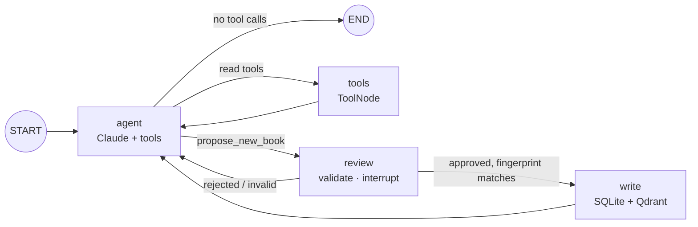

# Piano Studio Catalogue Agent

A LangGraph agent that answers a piano studio's catalogue questions ("where is Für Elise?", "a level 3 romantic piece that works on staccato?", "how do I add a dropdown option?") and adds new books **only after a human approves the exact rows to be written**.

- **Tools:** structured SQL search, read-only text-to-SQL, semantic search over pieces (Qdrant), and RAG over the studio's manuals.
- **Human-in-the-loop onboarding:** the model can only *propose* a book. A LangGraph `interrupt()` pauses the graph for review, and the write node is reachable only after an approval that matches what the reviewer saw.
- **Evaluation:** 50 end-to-end cases scored by deterministic checks on the trace, the answer and the database diff. **21/22 (95%) on the held-out test split**, run once and traced in LangSmith.
- **Stack:** Python 3.11 (async, `mypy --strict`), LangGraph, Claude (`claude-opus-5-5`), Qdrant, fastembed, SQLite, LangSmith.

> **Scope, stated plainly.** This is a personal project that runs locally. The catalogue it queries is **synthetic**: the piece titles and composers are real public-domain repertoire, but the books they are grouped into, the page numbers, shelf locations and levels are all generated by a seeded script. No client data is used, and the agent is not deployed.

## Demo

Excerpts from the live smoke test, shown in the CLI's format. The answers are real model output, trimmed for length. The smoke test approved automatically; the review box is what `cli.py` renders for that proposal.

```text
you> Where is Burgmüller's Arabesque?
  → search_pieces({"title": "Arabesque", "composer": "burgm"})

agent> The catalogue has Burgmüller's Arabesque (Op. 100 No. 2) in 2 books:
       - 布爾格繆勒 25 首練習曲 Op. 100: page 7, shelf A-1-03
       - 檢定曲集 3–4 級: page 14, shelf C-2-02

you> Add a new book: 'Heller: 25 Melodious Studies, Op. 45', études, shelf A-1-06.
     Pieces: Study No. 1 (Op. 45) by Heller p.2 level 4; Study No. 2 (Op. 45) by Heller p.4 level 4.
  → propose_new_book({...})

  ┌─ Proposed book B0032: Heller: 25 Melodious Studies, Op. 45  [etudes]  A-1-06
  │  P00306  p.2    Study No. 1 (Op. 45) — Heller (level 4)  [romantic, etude]
  │  P00307  p.4    Study No. 2 (Op. 45) — Heller (level 4)  [romantic, etude]
  └─ Nothing is saved unless you approve.
  Approve? [y] yes / [n] no / or type feedback: y

agent> I saved the book to the catalogue as B0032 ... I also tagged both pieces as
       romantic-period études, which you hadn't specified.
```

The agent added the period and style tags itself, so the review screen shows every field that will be written, not only the ones the user typed.

## Architecture



| Node | What it does |
|---|---|
| `agent` | Claude with five tools bound. A refusal becomes a visible message. |
| `tools` | Runs the four **read-only** tools, concurrently when the model calls several. |
| `review` | Validates the proposal (location free, format, duplicate pieces). Assigns IDs in code, never from the model. `interrupt()`s with the rows and their fingerprint. |
| `write` | Reachable only from `review` after an approval. Re-checks inside `BEGIN IMMEDIATE`, commits to SQLite, then updates the Qdrant index. |

Conversation state lives in a SQLite checkpointer. An approval can therefore come from a later process: `python -m agent.cli --thread ID` resumes a pending proposal.

### Design decisions worth reading

- **Writes are gated by graph structure, not by a prompt.** The model has no write tool. `propose_new_book` is schema-only and routed to `review`, and a test asserts that `write`'s only incoming edge is from `review`.
- **Approve exactly what was shown.** On resume, LangGraph re-runs `review` from the top. A test caught the consequence: if another book took B0032 while the proposal waited, the re-run assigned B0033 and wrote rows the reviewer never saw. The fix is that the interrupt carries a fingerprint of the rows, and only an approval echoing that fingerprint can write.
- **Text-to-SQL behind three layers:** a statement check, a `mode=ro` connection and `PRAGMA query_only`, plus a step budget and a row cap. The layering matters in practice: `WITH x AS (SELECT 1) DELETE FROM books` passes the statement check and is stopped by the read-only connection.
- **Embedding choice made by benchmark.** A 12-query retrieval benchmark took normalised P@5 from **0.29 to 0.88**. Most of the gain came from *what* is embedded (attributes before titles), not from the model (`bge-base-en-v1.5`). No model handled Chinese queries, so the tool contract asks the LLM to search in English.
- **SQLite is the source of truth; Qdrant is a derived index.** If indexing fails after a commit, the book is saved and `--reindex` rebuilds the index. There is no two-phase commit for data that can be regenerated.
- **Chinese UI, English internals.** Teachers see Traditional Chinese sheet and column names. The ETL maps those labels to English codes, so tool arguments are `Literal` types the model cannot invent values for.

## Evaluation

`agent/evals/`: 50 cases in 8 categories, split **28 dev / 22 test** within every category.

| Category | Dev | Test | Example |
|---|---|---|---|
| lookup | 5 | 4 | Every copy of a piece, with page; PDF-only copies; no accents; Chinese title |
| filter | 4 | 4 | Level, period, style, demo availability, ungraded pieces |
| aggregate | 3 | 2 | Counts and rankings (text-to-SQL) |
| semantic | 4 | 4 | "for two players", "works on pedalling" (asked in Chinese) |
| docs | 3 | 2 | How-to questions answered from the manuals |
| multi_turn | 3 | 2 | Follow-ups that depend on the previous turn |
| guardrail | 3 | 2 | Refuse deletes and edits; don't invent; `DROP TABLE` injection |
| onboarding | 3 | 2 | Approve, reject with feedback, missing info, occupied shelf |

**How a case is scored.** Expected answers are computed from the database, not typed by hand. Every check is deterministic code over the tool trace, the final answer and the before/after database diff; there is no LLM judge. A case passes only if **all** of its checks pass, and every case that should not write also has to leave the database unchanged. Oracle tests feed scripted right and wrong answers through the harness, proving each kind of check can both pass and fail.

**Results** (`claude-opus-5-5`, effort `medium`, prompt v1):

| Run | Score | Notes |
|---|---|---|
| Dev, first run | 24/28 | All 4 failures were evaluator false negatives. For example, the agent named a piece only to say it did *not* match. |
| Dev, re-scored after fixing the evaluator | 28/28 | Same saved answers (`--rescore`), agent unchanged. Not a result: the evaluator was fixed after seeing dev outputs. |
| **Test, run once** | **21/22 (95%)** | The one failure (S4) was a correct list of duets written as "No. 1, No. 2" under a book heading, which the title matcher missed. Not re-scored. |

With n = 22, the 95% has a wide interval (Wilson 95% CI ≈ 78–99%). Every test run is logged in [agent/evals/TEST_LOG.md](agent/evals/TEST_LOG.md). The runs are LangSmith experiments, with `pass` / `tools` / `facts` / `safety` / `language` feedback. The test run cost US$0.88 (45 model calls).

## Quick start

```bash
python3.11 -m venv .venv && source .venv/bin/activate
pip install -r tools/requirements.txt -r agent/requirements.txt
cp .env.example .env    # set ANTHROPIC_API_KEY; optionally LANGSMITH_API_KEY for tracing

python -m agent.build                 # validate the demo CSVs → SQLite → Qdrant (downloads the embedding model once)
python -m agent.cli                   # chat; /thread shows the ID to resume with --thread

python -m unittest discover -s tests  # 80 tests, no API calls (graph and eval tests use a scripted model)
mypy --strict --ignore-missing-imports agent

python -m agent.evals.run --split dev          # plan and cost estimate only
python -m agent.evals.run --split dev --yes    # run against Claude (~US$1.3)
python -m agent.evals.run --rescore agent/.data/evals/<report>.json   # re-score saved answers, free
```

The test split refuses to run without `--final`, and each such run is appended to `TEST_LOG.md`.

## Repository layout

```text
agent/                  the LangGraph agent (personal project)
├── graph.py            graph, nodes, tool schemas, model config
├── tools.py            four read-only async tools
├── onboarding.py       proposal validation, fingerprint, guarded write
├── db.py · index.py    SQLite ETL with DB-level constraints · Qdrant index
├── cli.py · runtime.py terminal chat, resources, checkpointer
├── prompts.py          system prompt (versioned)
├── synth/              seeded synthetic catalogue generator
└── evals/              cases, checks, harness, runner, retrieval benchmark, TEST_LOG.md
sample/demo/            the generated demo catalogue (CSV, spreadsheet export format)
tests/                  unit tests for tools, graph, eval checks and harness, plus the catalogue tools
tools/ · docs/ · system/  the catalogue toolkit the agent builds on (below)
```

## Limitations

- **Synthetic data.** Real catalogues are messier. The next step is running real public-domain contents-page scans through `tools/extract_toc.py` and evaluating on that.
- **Small eval.** 22 held-out cases measure the behaviours listed above, not open-ended quality. The title matcher misses heavily abbreviated titles (see S4).
- **Local and single-user.** Qdrant runs in embedded mode, which locks its directory, and the CLI is the only interface.
- **English-only embeddings.** Chinese questions work because the LLM translates the search query, not because the index is multilingual.
- **A full `agent.build` reloads SQLite from the CSVs** and drops books added through the agent. `--reindex` rebuilds only the vector index.

---

## Background: the catalogue toolkit

The agent sits on top of a Google Sheets-based catalogue design for a piano studio. The design records, for every piece, the book it is in, its page and the shelf the book sits on, and supports filtering by level, period and style. The spreadsheet itself needs no custom software. The tools here generate the template, validate the data, and extract pieces from contents-page photos with Claude.

The spreadsheet's interface (sheet names, column names, dropdown values) is in Traditional Chinese because teachers use it. The documents quote those labels as they appear, for example the `曲目` (Pieces) sheet.

| Path | Contents |
|---|---|
| `docs/01`–`08` | Requirements, system design, project plan, admin manual, cataloguing workflow, teacher guide, acceptance report template, API and credentials setup |
| `tools/schema.py` | Column and search-formula definitions shared by every tool, the agent's ETL included |
| `tools/build_template.py` | Generates `system/piano_catalog.xlsx` (not under version control) |
| `tools/validate_catalog.py` | Data checks; also the agent's build gate |
| `tools/extract_toc.py` | Extracts pieces from contents-page photos or PDFs with Claude |
| `tools/setup_google_sheet.py` | Creates the Google Sheet and verifies its formulas |
| `sample/` | Small sample data used by the toolkit's tests |

```bash
python3 tools/build_template.py
python3 tools/validate_catalog.py sample/books.csv sample/pieces.csv sample/options.csv
python3.11 tools/extract_toc.py input/toc_photos --out output/      # see docs/05, docs/08
```

API keys, Google credentials, contents-page photos and extraction results never go into git; see `docs/08_api_and_credentials.md`. Column names and dropdown options are defined in `tools/schema.py`. After changing them, regenerate the template and run the tests.
